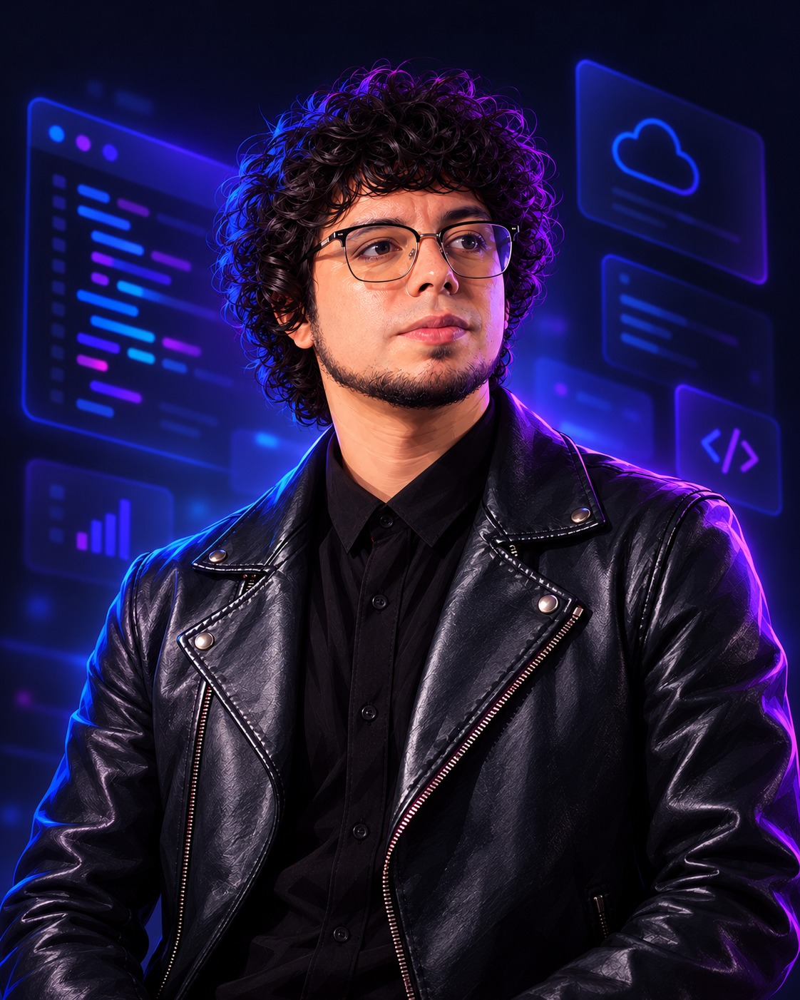

<p align="center">
  
</p>

<h1 align="center">👨‍💻 Hola, soy Alvaro Daniel Erazo ⚡</h1>

<p align="center">
  <a href="https://git.io/typing-svg">
    
  </a>
</p>

<p align="center">
  <a href="https://www.alvaroerazo.com"></a>
  
  
</p>


##  &nbsp;Sobre mí

<table>
<tr>
<td width="62%" valign="top">

```javascript
const alvaro = {
  rol:        "Desarrollador Full Stack",
  empresa:    "SIIGO",
  formacion:  ["Tecnólogo en Telemática",
               "Ingeniería de Sistemas (en curso)"],
  ubicacion:  "Popayán, Colombia",
  enfoque:    ["Frontend", "Backend", "Bases de datos"],
  aprendiendo: "Algo nuevo cada día 🌱",
  portafolio: "www.alvaroerazo.com"
};
```

</td>
<td width="38%" align="center">
  
</td>
</tr>
</table>

## 🛠️ &nbsp;Stack tecnológico

<table align="center">
  <tr>
    <td align="center" width="140"><b>BackEnd</b></td>
    <td></td>
  </tr>
  <tr>
    <td align="center"><b>FrontEnd</b></td>
    <td></td>
  </tr>
  <tr>
    <td align="center"><b>Bases de datos</b></td>
    <td></td>
  </tr>
  <tr>
    <td align="center"><b>Herramientas</b></td>
    <td></td>
  </tr>
</table>

## 📊 &nbsp;Actividad en GitHub

<p align="center">
  
  
</p>

<p align="center">
  
</p>

## 🚀 &nbsp;Proyectos destacados

<p>Mira mis repositorios fijados aquí abajo 👇</p>


